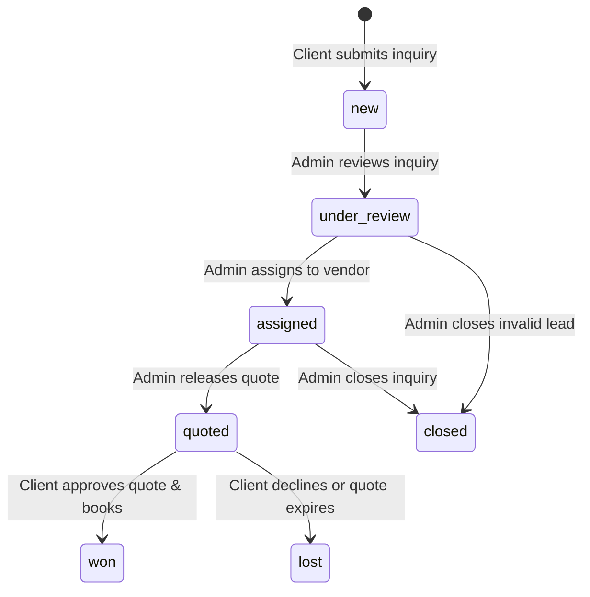
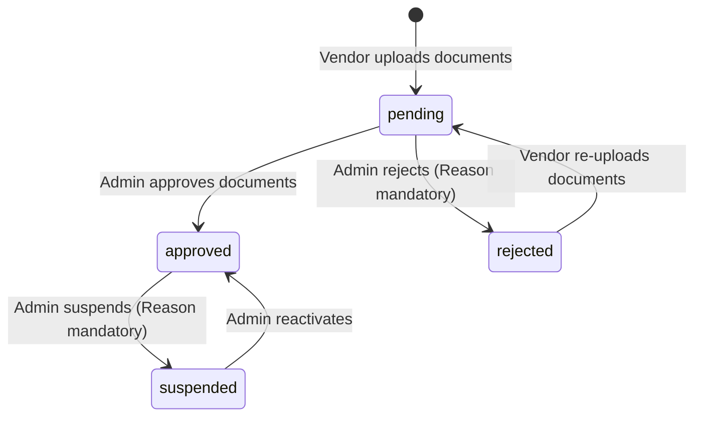
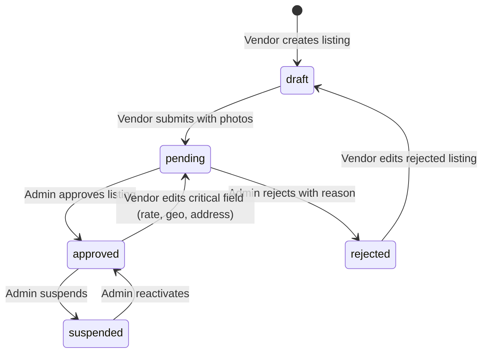
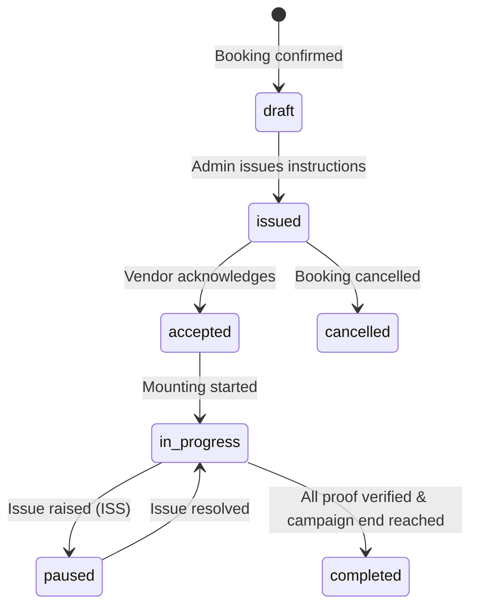
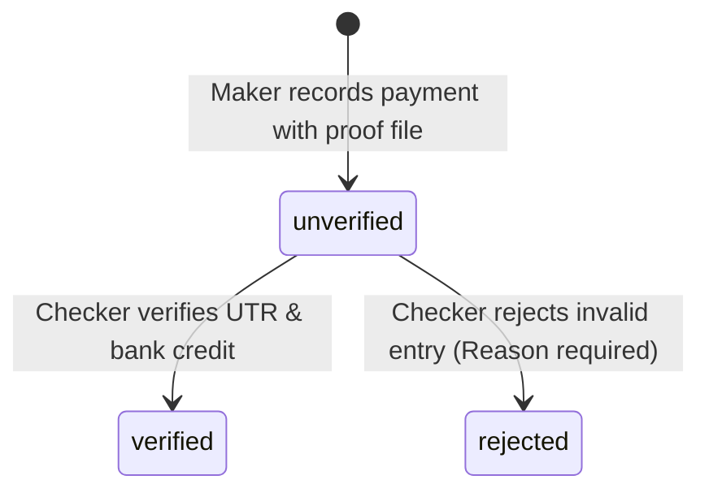

# OOHRENA — IDs and Status Transition Specifications

Source of truth: `packages/shared/src/ids.ts` and domain status models.
Core principle: **Client Transparency First** — every inquiry, quote, booking, work order, proof and payment has a unique, traceable, non-reusable identifier and strict state transitions.

---

## 1. ID Formats and Prefixes

All business entities use human-readable, sequentially generated IDs produced by `nextId("<PREFIX>")` (`apps/api/src/lib/ids.ts`). IDs are immutable and never recycled.

| Prefix | Entity | Format Pattern | Example | Notes |
|--------|--------|----------------|---------|-------|
| `USR` | User Account | `USR-000001` (6 digits) | `USR-000001` | System, Client, Vendor, Staff |
| `CLT` | Client Organization | `CLT-000001` (6 digits) | `CLT-000001` | Created upon client registration |
| `VND` | Vendor Organization | `VND-000001` (6 digits) | `VND-000001` | Created upon vendor registration |
| `GP` | Growth Partner | `GP-000001` (6 digits) | `GP-000001` | Partner portal access |
| `INV` | Media Inventory | `INV-<CAT>-000001` | `INV-HRD-000001` | Category code embedded (HRD, UNP, LED, etc.) |
| `LD` | Inquiry / Lead | `LD-YYYY-000001` | `LD-2026-000001` | Year-scoped inquiry ID |
| `QT` | Quotation | `QT-YYYY-000001-V<N>` | `QT-2026-000001-V1` | Carries version suffix |
| `BK` | Booking | `BK-YYYY-000001` | `BK-2026-000001` | Generated upon quote acceptance |
| `WO` | Work Order | `WO-YYYY-000001` | `WO-2026-000001` | One per vendor per booking |
| `CMP` | Campaign | `CMP-YYYY-000001` | `CMP-2026-000001` | Master campaign tracking container |
| `PRF` | Proof Submission | `PRF-YYYY-000001` | `PRF-2026-000001` | Uploaded campaign execution photo |
| `ISS` | Issue / Complaint | `ISS-YYYY-000001` | `ISS-2026-000001` | Execution defect or delay ticket |
| `TXI` | Tax Invoice | `TXI-YYYY-000001` | `TXI-2026-000001` | Official GST billing document |
| `CRN` | Credit Note | `CRN-YYYY-000001` | `CRN-2026-000001` | Refund / cancellation credit |
| `PAY` | Payment Transaction | `PAY-YYYY-000001` | `PAY-2026-000001` | Client receipt or vendor payout |

---

## 2. Status Transition Tables

Every state change is strictly validated against allowed transitions in `packages/shared`. Jumps not explicitly permitted return `409 INVALID_TRANSITION`.

### 2.1 Lead Lifecycle (`LEAD_STATUSES`)

- Allowed jumps:
  - `new` → `under_review`, `closed`
  - `under_review` → `assigned`, `closed`
  - `assigned` → `quoted`, `closed`
  - `quoted` → `won`, `lost`
  - `won`, `lost`, `closed` are terminal.

---

### 2.2 Vendor KYC Lifecycle (`KYC_STATUSES`)

- Allowed jumps:
  - `pending` → `approved`, `rejected`
  - `rejected` → `pending`
  - `approved` → `suspended`
  - `suspended` → `approved`
- **Rule:** Rejections and suspensions mandate an explicit, audited reason (min 5 characters).

---

### 2.3 Inventory Listing Lifecycle (`LISTING_STATUSES`)

- **Critical Field Guard:** Editing `lat`, `lng`, `address`, `city`, `pin`, `rate`, or `pricingUnit` on an `approved` listing automatically reverts status to `pending` with an audit record in `inventory_history`.

---

### 2.4 Quotation Decisions

- **States:** `draft` → `sent` → `approved` | `rejected` | `revised` | `expired`.
- **Client Approval:** Moves Quote to `approved` and unlocks booking generation.
- **Client Revision Request:** Moves Quote to `revised` and creates a new Draft quote with incremented version (`V2`, `V3`). Earlier versions remain read-only for audit history.
- **Client Rejection:** Requires minimum 3-character reason.

---

### 2.5 Work Order & Proof Execution Flow (`WO_FLOW`)

- **Proof Verification:** Uploaded proof (`PRF`) has status `submitted` → `verified` | `rejected`.
  - Rejection requires an explicit reason and reopens the proof schedule slot for re-upload.
  - Verified proof generates short-lived signed URLs for client transparency.

---

### 2.6 Financial Maker-Checker Controls

- **Inviolable Principle:** The user who records a payment (`recordedBy`) CANNOT verify it (`verifiedBy != recordedBy`).
- **Audit:** Hard-deletes of financial records are forbidden. All modifications prior to verification append to `payment_history`.
