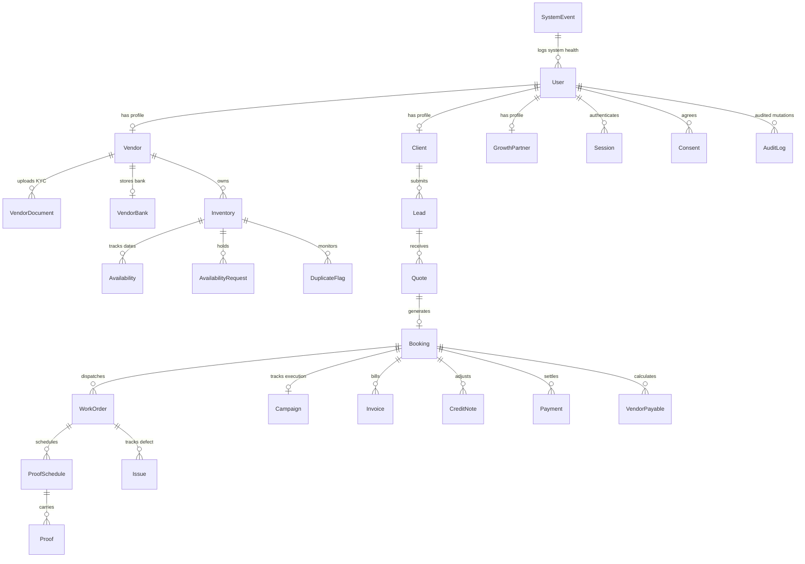

# OOHRENA — Database Schema & Architecture Reference

Source of truth: `apps/api/src/models/*` (MongoDB via Mongoose).
All business IDs are immutable strings stored as `_id`.

---

## 1. Entity-Relationship Diagram (ERD)

---

## 2. Collections & Indexes

### 2.1 Core Foundation (`models/foundation.ts`)

#### `users`
- **Fields:** `_id` (`USR-XXXXXX`), `email` (unique, lowercase), `mobile` (indexed), `fullName`, `passwordHash`, `role` (`client | vendor | admin | finance | growth_partner`), `orgId` (ref `clients`/`vendors`/`growth_partners`), `twoFactorSecret` (AES-256 encrypted), `twoFactorEnabled`, `twoFactorRecoveryCodes` (hashed), `failedLoginAttempts`, `lockedUntil`, `emailVerifiedAt`, `mobileVerifiedAt`, `status` (`active | suspended`), `suspendedReason`.
- **Indexes:** `{ email: 1 }` (unique), `{ mobile: 1 }`, `{ role: 1 }`, `{ orgId: 1 }`.

#### `sessions`
- **Fields:** `_id` (UUID), `userId` (ref `users`), `role`, `createdAt`, `expiresAt` (TTL), `reauthAt`, `ip`, `userAgent`.
- **Indexes:** `{ expiresAt: 1 }` (TTL index), `{ userId: 1 }`.

#### `clients`
- **Fields:** `_id` (`CLT-XXXXXX`), `userId` (ref `users`), `companyName`, `brandName`, `gstin`, `pan`, `billingAddress` (line1, line2, city, state, pin), `contacts` (array).
- **Indexes:** `{ userId: 1 }` (unique).

#### `vendors`
- **Fields:** `_id` (`VND-XXXXXX`), `userId` (ref `users`), `legalName`, `tradeName`, `pan`, `gstin`, `city`, `kycStatus` (`pending | approved | rejected | suspended`), `approvedBy`, `approvedAt`, `rejectedReason`.
- **Indexes:** `{ userId: 1 }` (unique), `{ kycStatus: 1 }`, `{ pan: 1 }`.

#### `vendor_bank`
- **Fields:** `_id` (`VND-XXXXXX`), `accountNumberEncrypted` (AES-256-GCM), `accountNumberMasked` (e.g. `••••••••1234`), `ifsc`, `bankName`, `branch`, `beneficiaryName`, `updatedBy`, `updatedAt`.
- **Indexes:** `{ _id: 1 }`.

#### `audit_logs`
- **Fields:** `_id` (ObjectId), `action` (string), `entity` (string), `entityId` (string), `before` (object), `after` (object), `reason` (string), `userId` (ref `users`), `role` (string), `ip` (string), `at` (Date).
- **Security:** Append-only at database role level (`mongo-app-role.js` restricts DB user to `insert` and `find` only).
- **Indexes:** `{ entity: 1, entityId: 1, at: -1 }`, `{ userId: 1, at: -1 }`, `{ action: 1, at: -1 }`.

---

### 2.2 Media Inventory (`models/inventory.ts`, `models/availability.ts`)

#### `inventory`
- **Fields:** `_id` (`INV-<CAT>-XXXXXX`), `vendorId` (ref `vendors`), `category` (`hoarding | unipole | led_screen | wall_wrap | transit | railway_metro | erickshaw_auto | mobile_led_van | indoor_retail`), `title`, `description`, `city`, `locality`, `landmark`, `address`, `pin`, `location` (GeoJSON Point: `[lng, lat]`), `rate`, `pricingUnit`, `quantity`, `attributes` (dynamic JSON schema per category), `photos` (array of `{ fileId, url, pHash }`), `status` (`draft | pending | approved | rejected | suspended`), `dataType` (`DEMO | VERIFIED`), `availabilityRev` (integer concurrency lock).
- **Indexes:** `{ location: "2dsphere" }`, `{ city: 1, status: 1 }`, `{ vendorId: 1 }`, `{ category: 1 }`.

#### `availability`
- **Fields:** `_id` (`<inventoryId>:<YYYY-MM-DD>`), `inventoryId`, `date` (`YYYY-MM-DD`), `capacity`, `used`, `state` (`available | limited | unavailable`), `updatedAt`.
- **Indexes:** `{ inventoryId: 1, date: 1 }` (unique).

#### `availability_requests` (Holds)
- **Fields:** `_id` (`HLD-XXXXXX`), `inventoryId`, `leadId`, `from`, `to`, `qty`, `status` (`held | booked | released | expired`), `expiresAt` (Date), `vendorResponse` (`pending | confirmed | declined`).
- **Indexes:** `{ inventoryId: 1, from: 1, to: 1 }`, `{ expiresAt: 1 }`.

---

### 2.3 Deals, Bookings & Execution (`models/lead.ts`, `models/booking.ts`, `models/execution.ts`)

#### `leads`
- **Fields:** `_id` (`LD-YYYY-XXXXXX`), `clientId` (ref `clients`), `createdBy`, `source`, `status` (`new | under_review | assigned | quoted | won | lost | closed`), `city`, `category`, `from`, `to`, `qty`, `budget`, `requirement`, `inventoryIds`, `assignedVendorId`, `createdAt`.
- **Indexes:** `{ clientId: 1 }`, `{ status: 1 }`, `{ assignedVendorId: 1 }`.

#### `quotes`
- **Fields:** `_id` (`QT-YYYY-XXXXXX-V<N>`), `leadId`, `version`, `clientId`, `items` (array with client rate, production, installation, vendor cost), `totals` (subtotal, serviceFee, gst, grandTotal), `status` (`draft | sent | approved | rejected | revised | expired`), `validUntil`, `approvedAt`, `revisionComment`.
- **Indexes:** `{ leadId: 1, version: 1 }` (unique), `{ clientId: 1 }`, `{ status: 1 }`.

#### `bookings`
- **Fields:** `_id` (`BK-YYYY-XXXXXX`), `quoteId`, `leadId`, `clientId`, `status` (`confirmed | in_progress | completed | cancelled`), `items`, `totals`, `from`, `to`, `cancellation` (`{ fee, refund, cancelledAt, reason }`).
- **Indexes:** `{ clientId: 1 }`, `{ quoteId: 1 }`, `{ status: 1 }`.

#### `work_orders`
- **Fields:** `_id` (`WO-YYYY-XXXXXX`), `bookingId`, `vendorId`, `status` (`draft | issued | accepted | in_progress | paused | completed | cancelled`), `instructions`, `creativeSpecs`, `items`, `issuedAt`, `completedAt`.
- **Indexes:** `{ bookingId: 1 }`, `{ vendorId: 1 }`, `{ status: 1 }`.

#### `campaigns`
- **Fields:** `_id` (`CMP-YYYY-XXXXXX`), `bookingId`, `clientId`, `name`, `status` (`running | completed | paused | cancelled`), `from`, `to`, `sitesCount`.
- **Indexes:** `{ bookingId: 1 }` (unique), `{ clientId: 1 }`.

#### `proofs`
- **Fields:** `_id` (`PRF-YYYY-XXXXXX`), `bookingId`, `workOrderId`, `campaignId`, `fileId`, `type` (`mounting | newspaper_day | newspaper_night | geotagged | completion`), `capturedAt`, `serverTimestamp`, `gps` (`{ lat, lng, accuracy, label }`), `status` (`submitted | verified | rejected`), `verifiedBy`, `verifiedAt`, `rejectionReason`.
- **Indexes:** `{ bookingId: 1 }`, `{ workOrderId: 1 }`, `{ status: 1 }`.

---

### 2.4 Billing & Finance (`models/finance.ts`)

#### `invoices`
- **Fields:** `_id` (`TXI-YYYY-XXXXXX`), `bookingId`, `clientId`, `status` (`issued | partially_paid | paid | cancelled`), `sacCode` (`998361`), `subtotal`, `cgst`, `sgst`, `igst`, `total`, `advanceDue`, `dueDate`, `issuedAt`, `placeOfSupply`, `isInterState`.
- **Indexes:** `{ bookingId: 1 }`, `{ clientId: 1 }`, `{ status: 1 }`.

#### `credit_notes`
- **Fields:** `_id` (`CRN-YYYY-XXXXXX`), `invoiceId`, `bookingId`, `clientId`, `cancellationFee`, `taxableAmount`, `cgst`, `sgst`, `igst`, `totalCredit`, `reason`, `issuedAt`.
- **Indexes:** `{ invoiceId: 1 }`, `{ bookingId: 1 }`, `{ clientId: 1 }`.

#### `payments`
- **Fields:** `_id` (`PAY-YYYY-XXXXXX`), `bookingId`, `direction` (`client_receipt | vendor_payout | refund`), `amount`, `mode` (`neft | rtgs | imps | upi | cheque | cash | card | other`), `reference` (UTR/cheque no), `paidOn`, `proofFileId` (encrypted upload), `status` (`unverified | verified | rejected`), `recordedBy`, `verifiedBy`, `verifiedAt`, `rejectionReason`.
- **Indexes:** `{ bookingId: 1 }`, `{ direction: 1 }`, `{ status: 1 }`.

#### `vendor_payables`
- **Fields:** `_id` (`<bookingId>:<vendorId>`), `bookingId`, `vendorId`, `base`, `gst`, `total`, `paid`, `balance`, `status` (`pending | due | partially_paid | paid | cancelled`).
- **Indexes:** `{ vendorId: 1, status: 1 }`.
