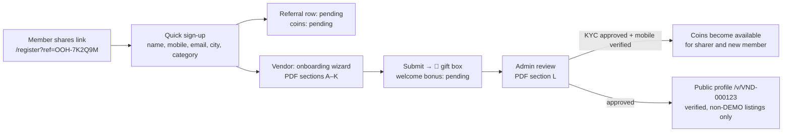
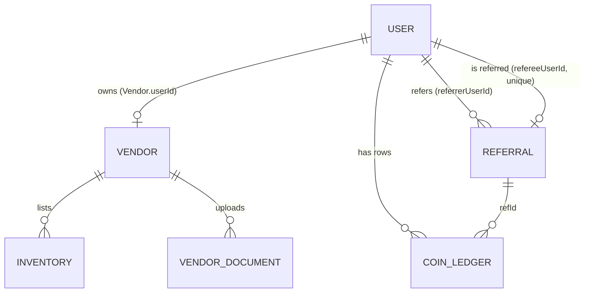
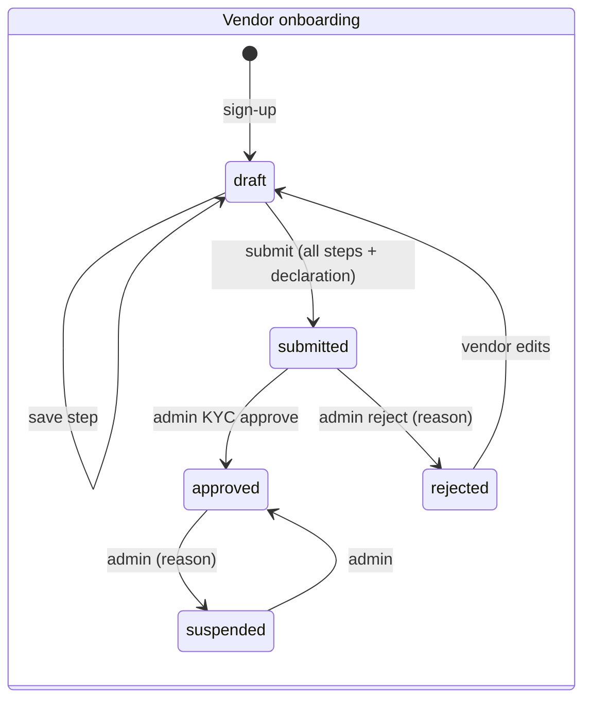
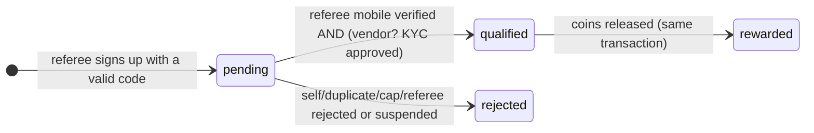

# Vendor onboarding, referral coins & vendor profile — architecture

Written 25 Nov 2026. Status: **approved design, build not started.**
Read with: `AGENTS.md` (rules), `docs/VENDOR_ONBOARDING_UX.md` (screens), `docs/VENDOR_ONBOARDING_REFERRAL_PLAN.md` (what and why), `docs/WEEKEND_BUILD_PLAYBOOK.md` (tasks T1–T10 and prompts).
If this file and the playbook disagree, **this file wins** — fix the playbook in the same PR.

---

## 1. The idea in one picture

The network grows like the tree in the poster: every member gets a code, every share that brings a real member earns coins, and the vendor tree (State → Zone → District → Area → Vendor) is added after the weekend on the same data.



## 2. Modules and boundaries

| Module | Owns | Code | Talks to others only through |
|---|---|---|---|
| **Identity** (exists) | User, session, mobile OTP | `routes/auth.ts`, `models/foundation.ts` | `referrals.onUserRegistered()`, `referrals.tryQualify()` |
| **Vendor onboarding** (new) | Vendor business / territory / execution / SLA / declaration data, onboarding progress | `routes/vendors.ts` (inside, see AGENTS §6), `services/onboarding.ts` | `referrals.onOnboardingSubmitted()` |
| **Vendor review** (extend) | KYC decision + PDF §L review | `routes/admin-vendors.ts` | `referrals.tryQualify()`, `referrals.onVendorRejected()` |
| **Referral & coins** (new) | Referral codes, Referral rows, CoinLedger | `services/referrals.ts`, `routes/referrals.ts`, `models/referral.ts` | nobody calls its models directly — only its service functions |
| **Public profile** (new) | nothing (read-only view) | `routes/public-vendors.ts` | reads Vendor + Inventory with the same "verified, non-DEMO" filter as search |
| **Network / Super Vendor** (T11, later) | Territory tree, vendor → area link, targets | `models/network.ts` | reads Referral for targets |

Rule: **only `services/referrals.ts` writes `Referral` or `CoinLedger`.** Routes and other services call its functions inside their own transaction (`session` parameter). This keeps every coin rule in one file.

## 3. Data model

All business IDs are `_id` and come from `nextId()`. New prefixes in `packages/shared/src/ids.ts`: `RFL` (yearly, pad 6), `CNL` (yearly, pad 6). T11 adds `TER` (not yearly, pad 6).



### 3.1 `User` (extend, `models/foundation.ts`)
| Field | Type | Notes |
|---|---|---|
| `referralCode` | string `OOH-XXXXXX` | unique sparse index. Generated in the sign-up transaction for client, vendor and growth partner users; not for staff. Alphabet without `0 O 1 I L` to avoid misreading. |
| `referredByCode` | string \| null | the code used at sign-up, stored only if it matched a user |

### 3.2 `Vendor` (extend)
| Field | Notes |
|---|---|
| `pan` | **optional** now (default null). Index `pan_1` replaced by a partial unique index `{ pan: 1 }, { unique: true, partialFilterExpression: { pan: { $type: "string" } } }`. Migration script `migrate:pan-index` (T2). |
| `categories[]` | `VENDOR_CATEGORIES` (PDF §B), min 1, set at sign-up |
| `business` | PDF §A: tradeName, designation, whatsapp, website, officeAddress{line1,line2,city,district,stateCode,pin}, businessType, yearEstablished, udyam, language |
| `territory` | PDF §C: primaryCity, primaryDistrict, **stateCode** (from `INDIAN_STATES` in shared — a code, not free text, so T11 can map vendors to the tree without cleanup), otherCities[], statesServed[] (codes), networkSize, approxSites, outsideCity, responseTimeH |
| `execution` | PDF §H |
| `sla` | PDF §I |
| `declaration` | PDF §K: accepted flags, textVersion `"2026-11"`, signatoryName, designation, place, signedAt, ip |
| `onboarding` | `{ savedSteps: { <step>: Date }, submittedAt: Date \| null }` |
| `review` | PDF §L (T8): identity, ownership, assets, permission, rateCard, siteVisitRequired, territoryNote, remarks, nextReviewDate, reviewedBy, reviewedAt |
| `network` | **reserved for T11, do not build now**: `{ level: state\|zone\|district\|area\|null, territoryId, parentVendorId }` |

### 3.3 `Referral` (new, `models/referral.ts`)
| Field | Notes |
|---|---|
| `_id` | `RFL-2026-000001` |
| `referrerUserId`, `refereeUserId` | `refereeUserId` **unique** — a person can be referred once, first code wins |
| `kind` | `b2b` vendor→vendor · `b2c` vendor→client · `c2c` client→client · `c2v` client→vendor · `sv` Super Vendor→anyone (off until T11) |
| `coins` | **snapshot** of the setting at creation. Changing the rate later never changes old referrals. |
| `status` | `pending → qualified → rewarded`, `pending → rejected`. Transitions in shared `REFERRAL_TRANSITIONS`. |
| `rejectReason`, `qualifiedAt`, `rewardedAt` | |
| Indexes | `{refereeUserId:1}` unique, `{referrerUserId:1, createdAt:-1}`, `{status:1}` |

### 3.4 `CoinLedger` (new, append-only)
A ledger, not a balance field. Same pre-hooks as `models/audit-log.ts`: every update / delete / replace / bulkWrite throws.

| Field | Notes |
|---|---|
| `_id` | `CNL-2026-000001` |
| `userId` | |
| `bucket` | `pending` \| `available` |
| `delta` | non-zero integer (coins are whole numbers) |
| `reason` | `referral_reward` \| `welcome_bonus` \| `release` \| `reversal` \| `admin_adjust` |
| `refType`, `refId` | e.g. `referral` / `RFL-…`, `user` / `USR-…`, `adjust` / pending-action id |
| `idemKey` | **unique index.** Makes every credit safe to retry and safe under races. Keys below. |
| `createdBy`, `createdAt` | `createdBy = "system"` for automatic rows |

**Idempotency keys (the core of "no double coins"):**
| Event | Rows inserted | idemKey |
|---|---|---|
| Referral created | +N pending (referrer) | `ref:<RFL>:hold` |
| Referral qualified | −N pending, +N available (referrer) | `ref:<RFL>:release:p`, `ref:<RFL>:release:a` |
| Referral rejected | −N pending | `ref:<RFL>:void` |
| Welcome bonus | +W pending (new member) | `welcome:<USR>:hold` |
| Welcome qualified | −W pending, +W available | `welcome:<USR>:release:p` / `:a` |
| Admin adjust | ±X available | `adjust:<pendingActionId>` |

A duplicate-key error on `idemKey` means "already done" → the service treats it as success. So calling `tryQualify` twice (mobile verified, then KYC approved, then a retry) can never pay twice.

**Balance** = `aggregate([{ $match: { userId } }, { $group: { _id: "$bucket", sum: { $sum: "$delta" } } }])`. Shared `walletBalance(rows)` does the same in tests and previews. A bucket must never go below zero — the service checks before inserting a negative row.

### 3.5 Settings (`packages/shared/src/settings.ts`, all sensitive → maker-checker)
`referral.coins.b2b` 100 · `referral.coins.b2c` 50 · `referral.coins.c2c` 25 · `referral.coins.c2v` 50 · `referral.coins.sv` 35 · `referral.welcome_bonus` 25 · `referral.daily_cap` 20 · `referral.require_kyc_for_vendor` true · `referral.enabled` true (kill switch: when false, codes are still stored but no Referral/coins are created).

## 4. State machines


`draft/submitted` is derived from `onboarding.submittedAt`; `approved/rejected/suspended` is the existing `kycStatus`. Don't add a second status field.



## 5. API contract

All under `/api/v1`. Every row: `requirePermission` + ownership filter + `validateBody(.strict())` + `audit`. Another user's record → 404.

| Method & path | Permission | Ownership | Body / query | Audit action | Errors |
|---|---|---|---|---|---|
| `POST /vendors/register` (change) | public | — | `registerVendorInput` (no PAN, + categories, + ref?) | `vendor.register` | 409 email/mobile taken |
| `POST /auth/register` (change) | public | — | `registerClientInput` (+ ref?) | `user.register` | 409 |
| `GET /vendors/me/onboarding` | `vendor.onboarding` | `req.user` vendor | — | — | |
| `PATCH /vendors/me/onboarding/:step` | `vendor.onboarding` + vendor role owner/manager | own vendor | schema per step | `vendor.onboarding.save` (PAN masked) | 404 unknown step, 409 `DUPLICATE_PAN`, 409 `INVALID_TRANSITION` after submit |
| `POST /vendors/me/onboarding/submit` | `vendor.onboarding` + owner | own vendor | `onboardingDeclarationInput` | `vendor.onboarding.submit` | 400 `{ missing: [...] }` |
| `PATCH /admin/vendors/:id/review` | `vendor.review` (verifier, admin) | all | `vendorReviewInput` | `vendor.review` | 400 reason missing on reject |
| `GET /referrals/me` | `referral.read` | own | `?page` → code, share link, current rates from settings, my referrals (masked) | — | |
| `GET /wallet/me` | `wallet.read` | own | `?page` | — | |
| `GET /wallet/:userId` | `wallet.read` (admin, finance, auditor) | all | — | `wallet.view` | 404 |
| `POST /wallet/adjust` | `wallet.adjust` (admin) | all | `coinAdjustInput` (reason ≥ 3 chars) | `coin.adjust.request` → checker approves → `coin.adjust` | 400, 403 maker = checker |
| `GET /public/vendors/:vendorId` | public, rate-limited | approved only, else 404 | — | — | 404 |

**Submit response** (used by the gift box, so the UI never computes coins):
```json
{ "data": { "submittedAt": "2026-11-29T10:12:00Z",
            "reward": { "welcomeBonus": 25, "pendingReferralCoins": 0, "status": "pending" } } }
```
Before T5 is merged, `reward` is `null` and the gift box is not shown.

**Referral list never exposes the other person**: referee shown as masked name (`Ra*** K***`) + kind + status + coins + date. No email, mobile or user ID.

## 6. Key flows (transactions)

**Sign-up with a code** — one `withTransaction`:
1. Create User (+ Vendor / Client org) → `nextId`.
2. Generate `referralCode` (retry ≤ 5 on duplicate key).
3. `referrals.onUserRegistered(user, session)`: look up code → checks (§7) → insert Referral `pending` + CoinLedger `ref:<RFL>:hold`. Any check failing → Referral `rejected` with reason (kept for fraud review), no coins. Unknown code → nothing stored, no error (don't reveal which codes exist).
4. `audit`. Commit. If anything throws, the user is not created either.

**Onboarding submit** — one transaction: validate all steps → save declaration → `onboarding.submittedAt` → `referrals.onOnboardingSubmitted(userId, session)` (welcome bonus `welcome:<USR>:hold`) → notify admins → audit → return `reward`.

**Qualification** — `referrals.tryQualify(refereeUserId, session)` is called from: mobile OTP verified (`auth.ts`) and KYC approved (`admin-vendors.ts`). It checks the conditions and, if met, releases both the referral reward (to the referrer) and the welcome bonus (to the referee). Safe to call any number of times (idemKeys).

**Rejection** — KYC rejected *finally* or user suspended → `referrals.onVendorRejected(userId, session)`: pending referrals where this user is referee → `rejected` + `void` rows. Available coins are never clawed back automatically; admin uses `wallet/adjust` with a reason.

**Referral link capture (web)** — landing on any page with `?ref=` saves `{ code, at }` in `localStorage` (try/catch) for 30 days, first touch wins; the register form pre-fills it and sends it. The server is the only judge of validity.

## 7. Security and anti-fraud

| Risk | Control |
|---|---|
| Self-referral | referrer.userId = referee → rejected; same mobile or email on both → rejected |
| Fake accounts farming coins | coins stay **pending** until mobile OTP verified + (vendor) KYC approved; daily cap per referrer; rate-limited register (existing `authLimiter`) |
| Same business twice | partial unique index on PAN; second vendor with same PAN → 409 at onboarding step 1 |
| Double credit (retries, races, two admins clicking) | `idemKey` unique index; balance computed, never stored |
| Code enumeration | unknown code ignored silently; `/register` rate-limited; codes 6 chars from 31-char alphabet (~887 M) |
| Editing history | CoinLedger + audit log append-only (pre-hooks); corrections are new rows |
| Admin abuse | `wallet/adjust` maker-checker via existing pending-action pattern; reason mandatory; audited |
| Privacy | referral list masks names; public profile returns an allow-list of fields (test asserts exact keys); PAN masked in audit and admin screens |
| Coins turning into money by accident | coins live only in `CoinLedger`, never in finance models, payables or invoices. Cash-out needs a new decision (Q2) and Finance maker-checker |
| Wrong role / other user's wallet | permission matrix + `userId` filter; other user's IDs → 404 |
| Turning it off fast | `referral.enabled` setting |

## 8. Web structure

| Piece | File |
|---|---|
| Hooks | `lib/vendor-onboarding-api.ts`, `lib/referral-api.ts` |
| Wizard | `components/app/vendor/OnboardingWizard.tsx` (+ one small component per step) |
| Gift box | `components/app/GiftBox.tsx` — CSS only, `prefers-reduced-motion` respected, shows `reward` from the submit response, opens once |
| Wallet | `components/app/WalletPanel.tsx`, tab on vendor, client, partner screens |
| Share | WhatsApp `https://wa.me/?text=` + copy button. Message text lives in one constant (`lib/share-text.ts`) so the owner can change wording/tagline ("The Global Media Kalpavriksha") in one place |
| Public profile | `routes/v.$vendorId.tsx`; `isPublicPath` accepts `/v/` prefix |
| Logo | owner sends SVG → `apps/web/public/brand/oohrena-logo.svg`; `PinLogo` in `kit.tsx` switches to it. Nothing else hard-codes the logo |

## 9. Ready for the Super Vendor tree (T11 — design only, don't build now)

- `Territory` collection: `_id TER-…`, `level` (state | zone | district | area), `name`, `parentId`, `path[]` (all ancestor IDs — "materialized path", so "everything under Rajasthan" is one indexed query `{ path: "TER-000001" }`).
- `Vendor.network.territoryId` = the area; `Vendor.network.level` set only for Super Vendors (admin, maker-checker, one per territory).
- Super Vendor sees vendors whose territory `path` contains their territory — that is the ownership check (others → 404).
- `sv` referral kind switches on; targets per level in settings.
- Because §3.2 already stores `stateCode` from a fixed list, existing vendors can be placed in the tree by state automatically and by district with a one-time admin mapping.

## 10. What we deliberately don't do
- No coin redemption, cash-out, or coin value in rupees (Q2 open).
- No multi-level coins (sharer's sharer gets nothing) — avoids MLM-style legal risk. Only the direct sharer earns.
- No device fingerprinting library (privacy + DPDP); mobile/PAN/email checks are enough for launch.
- No growth-partner coins: partners already earn through `partner.ts`. Codes are given to them for sharing, but `kind` for a partner referrer = no coins (setting can change later — Q10).
